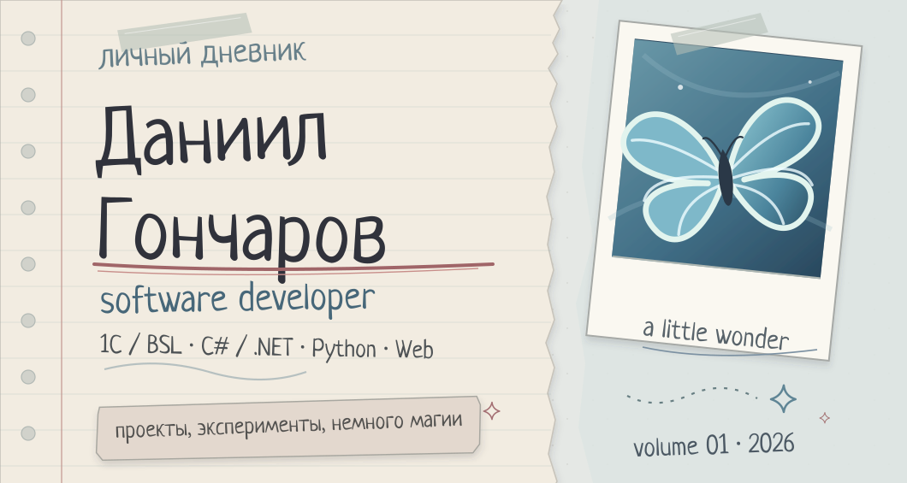
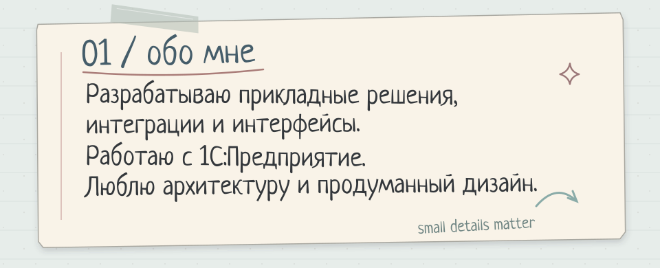
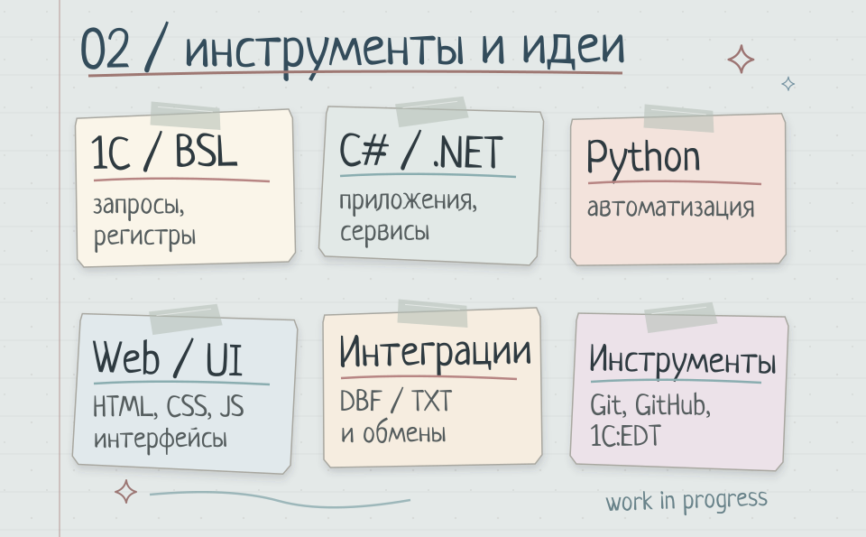
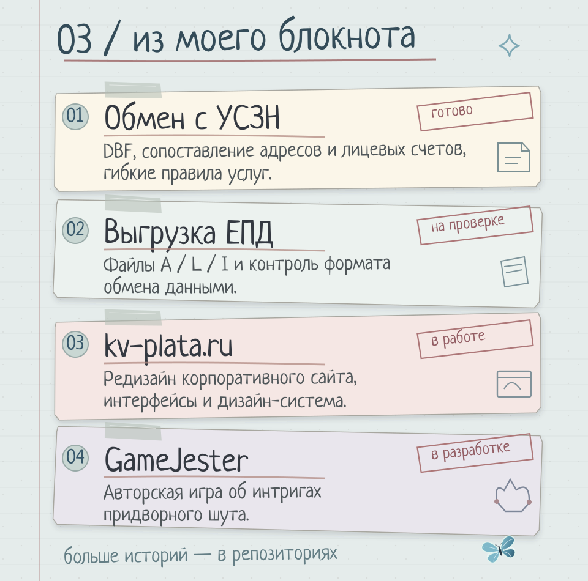

<!--
  PERSONAL DIARY / DESIGN REVISION 02
  Illustrations and layout are original. Letterforms are vector outlines rendered from Neucha (SIL OFL 1.1).
  Text-only transcript below preserves copy/paste and accessibility on GitHub.
-->

<a href="https://davins526.github.io/"><b>Портфолио</b></a> &nbsp; · &nbsp; <a href="https://github.com/davins526?tab=repositories">Все репозитории</a>

<a href="https://github.com/davins526/ToDoList">ToDoList</a> &nbsp;·&nbsp;
<a href="https://github.com/davins526/CalculatorATR">CalculatorATR</a> &nbsp;·&nbsp;
<a href="https://github.com/davins526/StorePet">StorePet</a>

Текстовая версия / Подробнее о проектах и технологиях

### Даниил Гончаров — Software Developer

Разрабатываю прикладные решения, интеграции и интерфейсы. Основное рабочее направление — **1С:Предприятие**. Мне близки понятная архитектура, надёжная логика и дизайн, который помогает решать задачи.

**Технологии:** 1С / BSL (запросы, регистры, внешние обработки, интеграции и обмен DBF / TXT); C# / .NET; Python; HTML, CSS, JavaScript, UI/UX, 1С-Битрикс; Git, GitHub, 1С:EDT.

**Обмен с УСЗН** — реализовано. DBF, сопоставление адресов и лицевых счетов, гибкие правила услуг.

**Выгрузка ЕПД** — передано на проверку. Формирование файлов A / L / I и проверка формата обмена.

**kv-plata.ru** — в работе. Редизайн корпоративного сайта и дизайн-система.

**GameJester** — в разработке. Авторская игра об интригах придворного шута.

Коммерческие кейсы описаны без клиентских данных и закрытого исходного кода.

1С:Профессионал · Даниил Гончаров · © 2026
