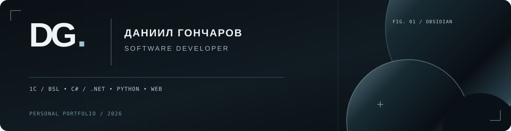

# davins526

### Привет, я Даниил.

**Software Developer · 1С / BSL · C# / .NET · Python · Web**

Разрабатываю прикладные решения, интеграции и интерфейсы. Основное рабочее направление — **1С:Предприятие**. Люблю понятную архитектуру, надёжную логику и дизайн, который помогает решать задачи.

**[Смотреть портфолио ↗](https://davins526.github.io/)** &nbsp;·&nbsp; [Мои репозитории ↗](https://github.com/davins526?tab=repositories)

 

---

### Технологии и направления

| Основное | Работаю и развиваю |
|:--|:--|
| **1С / интеграции** | BSL, запросы, регистры, внешние обработки, обмен DBF / TXT |
| **Разработка** | C# / .NET, Python |
| **Web / интерфейсы** | HTML, CSS, JavaScript, UI/UX, 1С-Битрикс |
| **Инструменты** | Git, GitHub, 1С:EDT |

### Избранные проекты

| Кейс | В двух словах | Статус |
|:--|:--|:--|
| **Обмен с УСЗН** | DBF, сопоставление адресов и лицевых счетов, гибкие правила услуг | Реализовано |
| **Выгрузка ЕПД** | Формирование файлов A / L / I и проверка формата обмена | Передано на проверку |
| **kv-plata.ru** | Редизайн корпоративного сайта и дизайн-система | В работе |
| **GameJester** | Авторская игра об интригах придворного шута | В разработке |

Коммерческие кейсы описаны без клиентских данных и закрытого исходного кода. Подробности — в портфолио.

### Публичный код

[ToDoList](https://github.com/davins526/ToDoList) &nbsp;·&nbsp; [CalculatorATR](https://github.com/davins526/CalculatorATR) &nbsp;·&nbsp; [StorePet](https://github.com/davins526/StorePet)

---

1С:Профессионал · DG. / OBSIDIAN · © 2026
